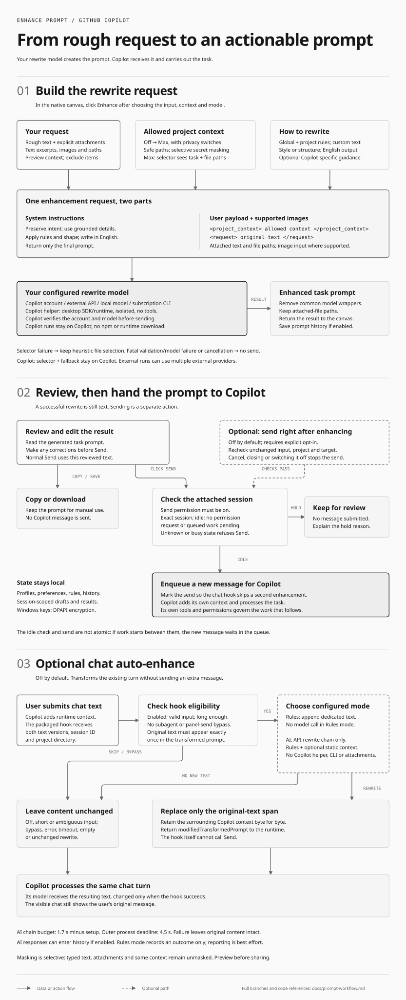

# Enhance Prompt for GitHub Copilot

Turn a rough request into a clear prompt using the project's files, rules and Git changes. Review the result in a native GitHub Copilot desktop canvas, then send it to that canvas's attached session.

[](docs/assets/prompt-workflow.svg)

[Read the complete workflow and editable diagrams](docs/prompt-workflow.md). The rewriting model produces the task prompt; Copilot receives that prompt and does the work. Optional chat auto-enhance changes the model-facing text while the visible chat keeps your original message.

The English-language React panel retains model chains and fallback, prompt styles, reusable rules and structures, attachments, context preview, and history. Rewritten instructions and headings are in English; your original text, custom rules, code, paths and quotations remain intact. Choose **GitHub Copilot** in Models to rewrite through your Copilot account in the background. External APIs, local models and subscription CLIs remain available as explicit alternatives.

[User guide](docs/user-guide.md) · [Changes](CHANGELOG.md)

## Download and install

**Development preview, version 0.3.0.** The `main` branch contains the Copilot plugin, including its built extension and panel. Install it from GitHub using the instructions below, or download a local copy for development. The package includes the root `plugin.json` and `com.github.copilot/` directory.

### Requirements

- [GitHub Copilot desktop](https://github.com/features/copilot) with canvas extension support, signed in to your account. This port targets the experimental SDK bundled with the Windows app on November 14, 2026.
- Node.js **22.18 or newer** on `PATH`; the packaged chat hook starts `node`.
- Copilot CLI available as `copilot` for the command-line installation below. If the command is missing, follow [GitHub's CLI setup instructions](https://docs.github.com/en/copilot/how-tos/copilot-cli/cli-getting-started).
- One rewrite model configured after installation. The **GitHub Copilot** preset reuses the desktop's SDK and running Copilot executable: no npm install, separate SDK/runtime download, or API key. The helper must resolve the same existing GitHub account as the attached session; desktop-only credentials that are not available to the helper will produce an unavailable message. External providers retain their own authentication and billing.

Windows supports encrypted saved API keys through DPAPI. On other systems, use a key available in the extension's environment or a subscription CLI; saved keys are unavailable. Desktop environments may omit shell environment variables. Other platforms have not been verified.

### Install from GitHub (recommended)

In Copilot, open **Customize → marketplace settings** next to the marketplace dropdown. Add `https://github.com/AndrewGodlewsky/copilot-enhance-prompt.git`, find **Enhance Prompt** under Browse, and click **Install**. [GitHub's desktop installation guide](https://docs.github.com/en/copilot/how-tos/github-copilot-app/customize-github-copilot-app#adding-plugins).

Or use the CLI:

```sh
copilot plugin marketplace add AndrewGodlewsky/copilot-enhance-prompt
copilot plugin install enhance-prompt@copilot-enhance-prompt
copilot plugin list
```

This installs a cached copy, matching the working Usage Insights setup. Copilot desktop 1.4.2 omitted Enhance Prompt's logo from session metadata when it was loaded through a local directory marketplace. Switching to the GitHub install restored the exact SVG in both affected sessions without changing the plugin version. After restarting Copilot, the owner confirmed that the top tab displays the logo. See [repair an existing local installation](#repair-an-existing-local-installation) if that marketplace name is already registered locally.

To select a published branch or tag, use `"AndrewGodlewsky/copilot-enhance-prompt#COPILOT_REF"` as the marketplace source. Built extension and panel files are included; users do not need `npm install` or a build step.

### Download a local copy for development

If you already have this Copilot checkout, use it directly. Otherwise, [download the main branch as a ZIP](https://github.com/AndrewGodlewsky/copilot-enhance-prompt/archive/refs/heads/main.zip) and extract it, or clone it with Git:

```sh
git clone --branch main https://github.com/AndrewGodlewsky/copilot-enhance-prompt.git
```

Local marketplaces load edits directly from the folder, but the desktop's session logo lookup can fail for this installation type. Use the GitHub installation above for normal use.

Open PowerShell in the extracted repository root, the folder containing `plugin.json`. Run:

```powershell
copilot plugin marketplace add (Get-Location).Path
copilot plugin install enhance-prompt@copilot-enhance-prompt
copilot plugin list
```

The first command registers the marketplace. The second installs and enables the plugin. Check that `enhance-prompt` appears in the list. From another shell, replace `(Get-Location).Path` with the quoted absolute path to the folder.

Keep that folder: plugins installed from a local marketplace load directly from it. To use changes, start a new session or restart the existing one. [GitHub's plugin command reference](https://docs.github.com/en/copilot/reference/copilot-cli-reference/cli-plugin-reference).

### Repair an existing local installation

If the native tab shows generic squares, and this marketplace was added from a folder, switch its source to GitHub:

```sh
copilot plugin uninstall enhance-prompt@copilot-enhance-prompt
copilot plugin marketplace remove copilot-enhance-prompt
copilot plugin marketplace add AndrewGodlewsky/copilot-enhance-prompt
copilot plugin install enhance-prompt@copilot-enhance-prompt
```

Run each command only after the preceding command succeeds. For a live local install, uninstall disables the plugin; it does not delete the source folder. The plugin stores preferences, models, encrypted keys, and history separately from its installation. Restart Copilot after switching and reopen the installed canvas so the desktop reloads its plugin inventory. Future updates come from GitHub through `copilot plugin update enhance-prompt@copilot-enhance-prompt`.

### Open the canvas

In **Customize → Installed**, check that Enhance Prompt is enabled. Open a session for your project, then ask Copilot to **open the installed Enhance Prompt canvas**. You can also look for it in Customize's Canvas view. Use the installed canvas, rather than `/create-canvas`, which creates a new extension. Start a new session if the newly installed extension has not appeared. [Canvas documentation](https://docs.github.com/en/copilot/how-tos/github-copilot-app/working-with-canvas-extensions).

To update a local install, replace or update the files in its existing folder and start a new session; rebuild first if you changed source code. For a GitHub install, run `copilot plugin update enhance-prompt@copilot-enhance-prompt`. Remove either installation with `copilot plugin uninstall enhance-prompt@copilot-enhance-prompt`.

The native tab uses the compact SVG declared in `plugin.json`. Version 0.1.5 removed the unused canvas icon override; the larger PNG remains the favicon. A successful Installed-row logo does not establish that the session's tab received its logo. Opening a new session alone was not a reliable repair for the local installation. See the [icon investigation](docs/canvas-icon-investigation.md) for the measured failure and installation workaround.

## Use it

**General** is the default style. Use **Context** to choose how much project information to include, and **Style** to choose how the task should be expressed. [Guide to all nine styles](docs/styles.md).

Choose **Relevant code** for most coding tasks: it adds local source matches without an extra model call. **Project overview** stays the default for quick orientation; **AI-assisted** adds model-based file selection when needed. **Off** keeps only the inputs you supply. Saved Basic selections remain compatible. [Context choices and limits](docs/context-levels.md).

The Quiet Desk banner changes its still scene with local time and the current enhancement state. Use the single button at its top right to toggle light/dark mode; your choice is remembered across sessions. The footer links to this repository, Settings, Show Logs and Feedback, with the version in plain gray text. Release notes appear once after an update. See the [user guide](docs/user-guide.md) for the scene's triggers and support logs.

1. In **Models**, click **Add a model**, keep the **GitHub Copilot** preset, choose a model from the live list, and save. Existing profiles are preserved; select the new Copilot profile explicitly in Enhance if another profile was already first. Claude models in this preset use GitHub Copilot, not Claude Code. The separate Claude Code preset still uses Claude Code's authentication and billing.
2. In **Enhance → Write a request**, describe the task and choose **Context Level**, **Style**, and **Effort**. Assign Low, Medium, and High to models in **Settings → Effort models**; all three initially use your current model. **Options** opens structures and the context preview. Uncheck items to exclude them; use **Attach files** for explicit attachments.
3. Click **Enhance**. The request locks while a small stick-figure crew rearranges a decorative copy of its words. Progress reports the real context and model steps; Cancel stops the run. On success, the figures put their words down where they are standing, then exit and the words slide downward together, then your original request becomes editable again. **Pause animation** pauses only the artwork. Reduced-motion preferences skip the artwork.
4. In **Review and send**, edit the enhanced prompt. **Send to Copilot** submits a new message to the attached session shown in **Send to**. **Copy** keeps the handoff manual. The download icon saves a file; the up-arrow uses the result as a new input for refinement.

In the request box, **Enter** adds a line. Enter and modified Enter keys never start enhancement or send a prompt: use **Enhance**. In the result box, **Ctrl+Enter** (or **⌘+Enter**) sends your edited text. If you explicitly enable **Send right after enhancing**, the separate **Enhance and send** button can skip review; **Enhance** still stops at the result. Navigation has visible labels, controls have keyboard focus indicators, and segmented choices support arrow keys.

**Effort** chooses the rewriting model, independently of context and style. It does not change a model's internal reasoning setting or the separate chat auto-enhance model. The assigned model appears beneath the controls, and results identify the model actually used, including fallback. [Effort assignments and migration](docs/settings.md#effort-models).

Send refuses busy, blocked, queued, disconnected or unknown sessions. It never answers a pending permission request. Copilot's SDK has no atomic “send only if still idle” operation: the plugin checks immediately before sending and uses the normal queue, never immediate steering. If work starts between those operations, the message waits in the queue.

**Send right after enhancing** is optional, off by default, and requires its confirmation dialog. It checks that the session, project and input are unchanged and that the session is idle. [Details](docs/settings.md).

## Platform differences

### Background Copilot rewriting

Enhance starts a disposable, hidden helper using the SDK and executable supplied by the running desktop host. It sends only the prepared rewrite instructions, permitted context and explicit attachments. It does not open a chat window, copy the attached chat history, change its model, or send the result into that session until you use Send.

Before inference, the plugin checks both sessions' GitHub identity and Copilot model availability. The helper has an empty working directory, no tools, denied permissions, and disabled plugins, hooks, skills, automatic instruction discovery, shared session storage and memory. Cancellation stops the helper; normal completion removes its temporary home. A crash or failed shutdown can leave temporary files for OS cleanup. Copilot profiles never fall back to an external provider, including at AI-assisted context's AI file-selection step.

Copilot usage is billed under the account's Copilot plan; AI-assisted context can make an additional model request. The two-second chat auto-enhance hook still supports Rules or API models only. The desktop owns SDK/runtime updates. This experimental integration checks required APIs and runtime state and refuses incompatible setups; future desktop changes may still require a plugin update. See [security and compatibility details](docs/copilot-background-rewriting.md).

**Usage Insights visibility:** Enhance Prompt 0.2.4 keeps local accounting records; [Usage Insights](https://github.com/AndrewGodlewsky/copilot-usage-insights) 0.1.64 discovers them automatically. Update **both plugins**, restart Copilot, run an enhancement with a GitHub Copilot model, then refresh Usage Insights. Look for the **Enhanced Prompt** project and its separate timestamped sessions. AI-assisted context's file selection, model tests and fallback attempts can each create another session. This is a dashboard grouping; no desktop project or chat window is created.

Only reported model, timestamp, token and credit accounting is exported, without prompts or responses. Missing charges remain unavailable rather than zero. Existing deleted receipts cannot be recovered; tracking starts with this version. [Storage, privacy and coverage details](docs/copilot-background-rewriting.md#usage-visibility).

Building another plugin that needs background Copilot models? Use the [agent handoff](docs/copilot-sdk-agent-handoff.md) for the host SDK/runtime setup, account and model checks, isolation, cancellation, retained usage, Usage Insights integration and fixture tests.

| Capability | Copilot behavior |
| --- | --- |
| Prompt editor, rewrite models, fallback, rules, history, attachments | Retained in the canvas |
| Destination picker | The canvas's attached Copilot session |
| Optional Enter after paste | Replaced by explicit Send as a new chat message |
| Automatic prompt rewriting | Optional transformed-prompt hook; changes model-facing text while the chat shows the original; off by default |
| Terminal scrollback and other-agent context | Unavailable with the current adapter |
| New external CLI agent, editor-save events, opening editor tabs | Unavailable with the current canvas SDK |
| Desktop notifications | Unavailable; progress and completion appear in the panel |
| Save dialog | Browser download |

Unavailable settings are disabled and explained. Switching the visible desktop tab does not retarget an existing canvas. Open the canvas in the intended session.

## Data and privacy

The worker reads the project directory from Copilot session metadata, never from its session-artifact directory. Remote workspaces expose no local project files. Project reads obey privacy switches and reject sensitive filenames and escaping symlinks. Recognized secrets in automatically collected project instructions, README/extra context, stack information, source excerpts and Git metadata/diffs are masked before trimming. Explicit attachments, your request and custom instructions are not automatically secret-masked. Preview and exclude context before enhancing. External-provider fallback can send the payload to multiple configured providers. Copilot selection confines both fallback and AI-assisted context's file selector to Copilot profiles. [Exact data flow](docs/prompt-workflow.md).

Preferences, profiles, rules and history are local. Saved prompt history is not encrypted; drafts and results are scoped to the Copilot session. Windows API keys use DPAPI under the current Windows account; they are never saved as plain text. The default data directory is `%LOCALAPPDATA%/copilot-enhance-prompt` on Windows and `~/.local/share/copilot-enhance-prompt` elsewhere. `ENHANCE_PROMPT_DATA_DIR` overrides it for tests or a separate installation.

The canvas uses an authenticated loopback server with origin and path checks. It exposes no agent-callable send, credential or consent action. There is no tracking or analytics. [Privacy details](docs/privacy.md).

## Development

Install dependencies and rebuild the packaged extension and panel after changing source:

```sh
npm ci
npm --prefix web ci
npm run typecheck
npm test
npm run build
npm run check
npm run web:dev
```

The development panel runs at `http://localhost:5174` with sample data, without model calls or real sends. Use `?theme=dark&width=380`, `?tab=models`, or `?demo=fix+the+login+page` to preview states.

`scripts/e2e.mjs` loads the built package in an isolated installed Copilot runtime and exercises canvas discovery, project metadata, context preview, enhancement, sending and the packaged prompt hook. Its disposable session uses a local model fixture; no external model is called. Set `COPILOT_SDK_DIR` and `COPILOT_CLI_PATH` to the desktop SDK directory and runtime executable. See [AGENTS.md](AGENTS.md) for the architecture and behavioral invariants.

`node scripts/e2e-runtime-identity.mjs` uses those same paths to check both the desktop's embedded bootstrap and the SDK's absolute-path bootstrap. It verifies SDK loading and repeated model-list refreshes against a synthetic catalog, without accessing an account or existing session. It also checks that the embedded bootstrap ignores a same-named file in the working directory.

`node scripts/e2e-model-access.mjs` compares the native workflow and headless SDK against a local fixture. `node scripts/e2e-copilot-provider.mjs` exercises the production helper's output, model selection, tool/context isolation, cancellation and temporary-state cleanup with the installed SDK. Both use the same environment variables. Account/catalog identity is synthetic in the production-helper fixture, and inference never reaches a paid provider. Read-only authentication discovery has also been checked in a disposable extension, but an actual account-backed rewrite and desktop behavior require user validation. See the [model-access validation findings](docs/research/copilot-model-access-validation.md).

The current port has passed unit tests, type checks, package checks and that installed-runtime integration test. Desktop visual verification remains unfinished; the preview is not a published stable release.

## License and attribution

This is a fork of [Enhance Prompt](https://github.com/cattfan/orca-enhance-prompt), originally created by [cattfan](https://github.com/cattfan). It adapts that work for GitHub Copilot. Credit for the original plugin's design and implementation belongs to its original author and contributors.

This fork is distributed under the [MIT License](LICENSE). The complete original license, including `Copyright (c) 2026 cattfan`, is preserved unchanged. Include that license with copies or distributions of this plugin, including packaged builds.

This fork is not affiliated with GitHub or the model providers. [Report an issue](https://github.com/AndrewGodlewsky/copilot-enhance-prompt/issues).
