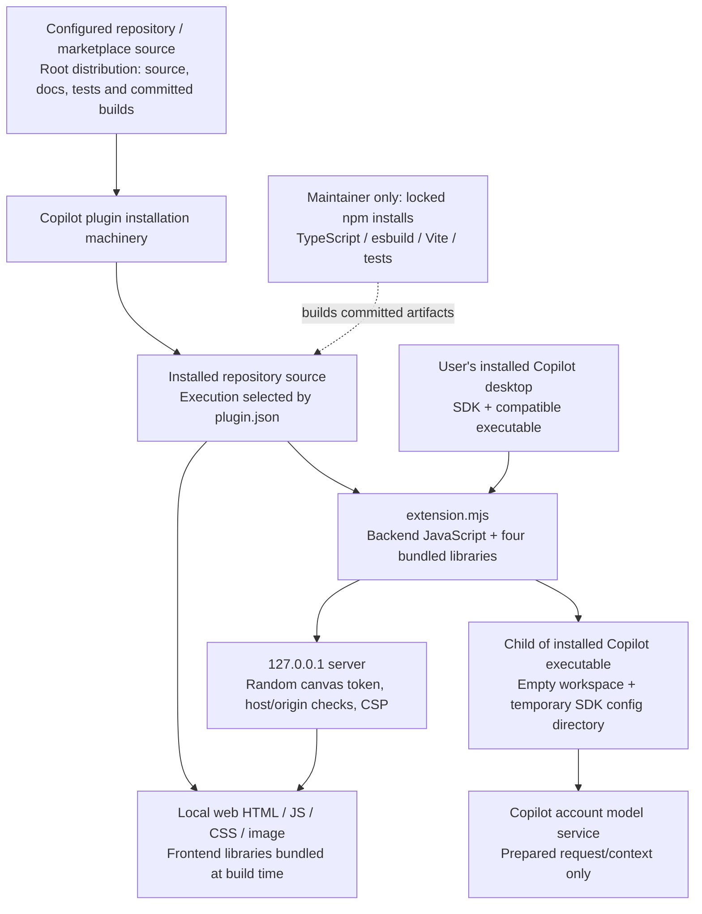
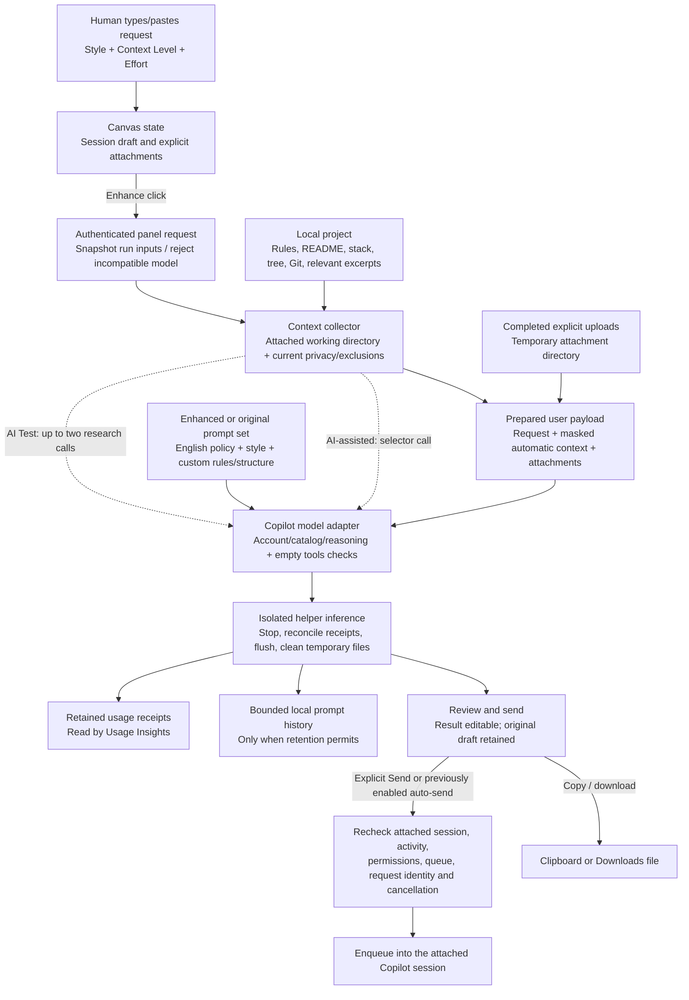
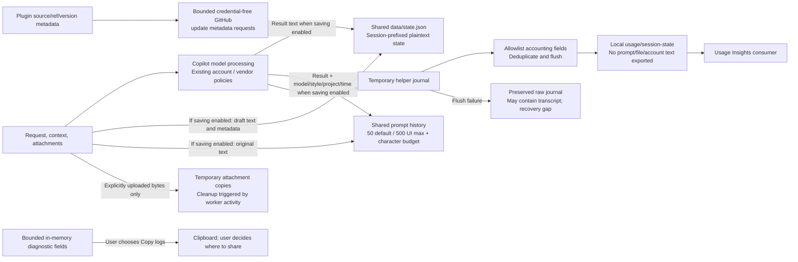
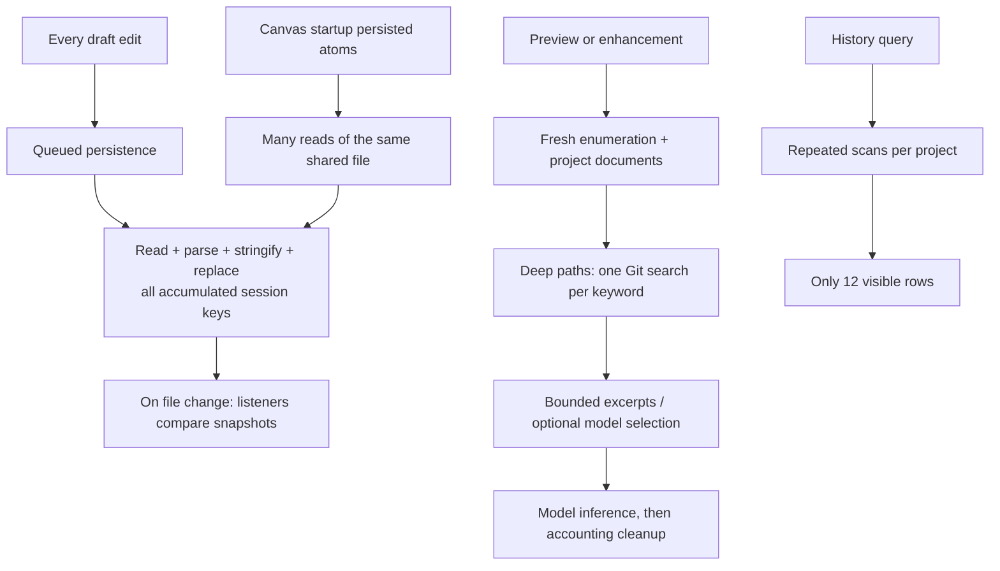
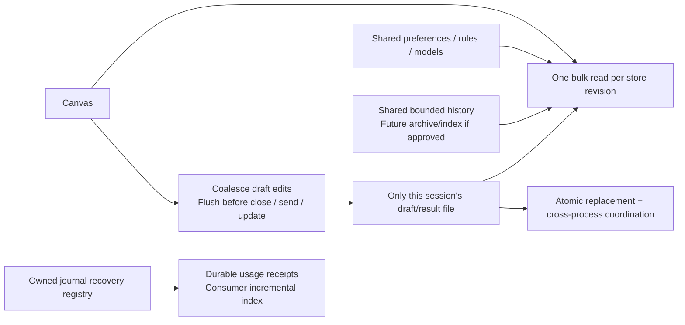

# Execution, data and performance diagrams

These diagrams describe **0.12.0 at d25be463**, followed by one explicitly proposed storage design. They are source-reviewed maps, not evidence that every runtime boundary is secure. Finding IDs link the weak points to the [readiness checklist](README.md) and detailed security reports.

## What is downloaded and what executes

The extension runs with the user's OS permissions. Token/origin protection prevents an unrelated website from simply calling the local API; it is not an OS sandbox against another same-user process. The helper's disabled tools/discovery and checked directory/account/model are valuable application controls, not a substitute for the host runtime's security. Normal installation does not run this repository's npm build or download a separate SDK. See the [exact package inventory](distribution-readiness.md#what-users-receive-and-execute).

## End-to-end enhancement

Context depth and effort are separate. Effort selects the model/reasoning; it can also affect selector/research inference when no separate selector is configured. It does not automatically increase context budgets. Attachments and typed/custom text are intentionally not automatically secret-masked. The rewriter should treat project text as evidence, but model obedience is not a security guarantee; output remains subject to human review. Automated chat interception is retired.

Confirmed exceptions to the intended diagram: privacy can become stale during file selection and history persistence (finding 2); configured Git filters can execute during collection (1); pending uploads can be absent from the snapshot (12); cancellation can arrive during send checks without preventing enqueue (3). These are fix requirements, not claims that the diagram already enforces every arrow correctly.

## Data lifetime and recipients

Preferences have a separate file; rules, models and history share the data store with session state. Draft metadata includes attachment paths and context-item summaries, not attachment bytes or raw automatic excerpts. “Delete everything” currently covers history/configuration/current-session panel state and attachments, not every old session draft, exported downloads, Copilot conversations, or usage receipts. No automatic upload of diagnostics or usage exists in the plugin. Attachment cleanup is activity-triggered, so “one day” is a threshold checked on startup/upload, not a guaranteed timer while the plugin is disabled. The temporary SDK configuration directory does not replace the user's OS HOME; existing account discovery remains available to the runtime.

## Where time and work accumulate

Full-file persistence and repeated search are the first optimization targets. Model latency is an additional unmeasured cost in this audit. Pagination bounds rendered rows but not the full history scan. See [measured costs and trade-offs](performance.md).

## Update lifecycle and cancellation hazard

```mermaid
stateDiagram-v2
  [*] --> DueCheck: Canvas opens or manual check
  DueCheck --> Cached: Disabled / not due
  DueCheck --> Resolve: Due and allowed
  Resolve --> Unavailable: Local, pinned, uncertain or unsupported source
  Resolve --> Current: Running and installed match available
  Resolve --> Reload: New version already installed
  Resolve --> Available: New version at configured source
  Available --> Available: Later / view changes
  Available --> Revalidate: Human clicks Update
  Revalidate --> Busy: Active work or duplicate reservation
  Revalidate --> Installing: Identity and source verified; reserve work
  Installing --> Pending: Timeout or connection loss
  Pending --> Verify: Reconcile before any retry
  Installing --> Verify: SDK request returns
  Verify --> Failed: Inventory or provenance mismatch / refusal
  Verify --> Reload: New installed version verified
  Reload --> Current: User restarts supported host and reopens
```

Updates use the attached session's plugin operation, never an agent-callable action or alternate installer after a policy refusal. A request reporting success is insufficient: inventory is re-read. On the previously recorded runtime, restarting Copilot is required; this audit did not rerun a live install/restart. **Finding 5:** cancellation currently releases a work reservation before helper cleanup finishes, so the `Busy` guard can stop protecting that interval. Keep reservations through cleanup and accounting, even when the UI caller has stopped waiting.

## Proposed storage improvement — not implemented

This keeps reopen convenience, history, animation, model choices, receipt preservation and context levels. It requires migration, stale-reader invalidation, concurrency tests and recovery, rather than a new framework. Automatic expiry, a full-history archive and any reduction in AI research are separate user decisions.
