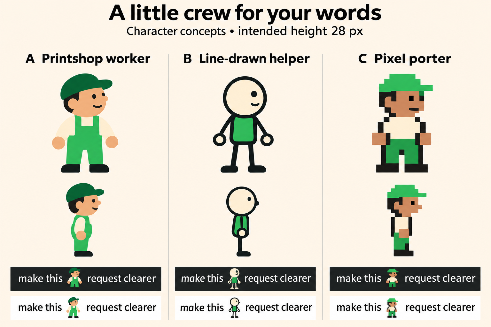

# Word crew character concepts

Status: awaiting character approval. This is a static design exploration, not a shipped feature. The plugin remains at version 0.4.0.

The proposed app height is **28 CSS pixels**, approximately two stacked 14-pixel text lines. The enlarged views show the character design; the small text strips illustrate relative size, not a pixel-accurate screenshot of the plugin. Exact scale and silhouette will be checked in the animation prototype.

| Option | Character | Design reason |
| --- | --- | --- |
| A | Printshop worker | Green overalls, a cap, visible hands and short legs. Recommended because the silhouette suggests someone physically carrying words and fits the existing desk artwork. |
| B | Line-drawn helper | A minimal human with articulated limbs and round hands. Use light limbs on dark surfaces and dark limbs on light surfaces. |
| C | Pixel porter | A small retro worker with square hands and a green cap. A deliberately different, pixel-art direction. |

Use the existing Lift green and flat colors for the eventual character assets. Keep the approved plugin icon and still Quiet Desk banner unchanged. The generated sheet is an art-direction reference; it is not a production sprite sheet.

## Approval order

1. The owner chooses or revises the character design.
2. Create an isolated animation prototype for approval: running, reaching, lifting, carrying, placing and exiting.
3. After animation approval, integrate the chosen animation into the composer and verify its workflow behavior.

The owner explicitly requested these two approval stages before implementation. No animation or production UI code is included in this change.

## Requested eventual behavior

- Clicking Enhance starts a little crew inside **Write a request**, approximately one character for every ten words.
- The characters choose words, lift them, carry them to other positions and put them down. Words may leave and new decorative words may arrive; the visual text can be scrambled.
- Lock request editing while the enhancement runs. Preserve the original request as data; moving decorative words must never change the model input, saved draft or actual generated result.
- Keep the existing progress bar visible. When actual enhancement reaches completion, the crew runs off-screen and a descending bar visually pushes the displayed text toward the result section.
- Failure and cancellation restore the editable original request. They must not play a successful-completion effect.

For the next prototype, settle exact sizing against the real composer font, short/long-request crew counts, clipping and word spacing, completion timing, theme contrast and reduced-motion behavior. The animation must remain separate from model progress and sending consent. No desktop or browser UI automation is authorized.
