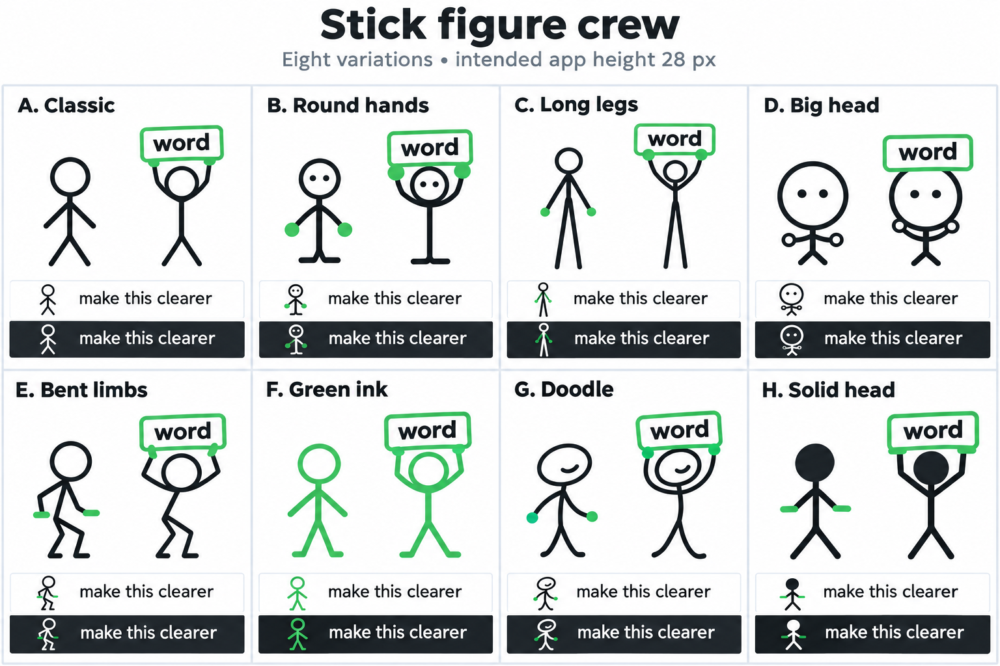

# Word crew character concepts

Status: **Classic stick figure and animation approved; integrated in version 0.5.0.** The standalone preview remains a design reference.

The owner selected **A — Classic** from the eight stick figures below, with one correction: the people must pick up the words themselves, with no surrounding box or tile.

## Animation preview

Open [animation-preview.html](animation-preview.html) locally and click **Enhance preview**. It is a standalone HTML file with no install, network requests, model calls or saved data. It is also presented inline in the design conversation. The preview does not modify the plugin.

- Hollow round heads, a simple line torso and bare line hands; no faces or clothing. Characters measure 28 pixels during carrying at actual size, alongside 14-pixel text.
- Reach, lift, walk, set down and release use continuous positions. While carrying, the hand endpoints and the bare word share coordinates, including the slight walking bob. The word has no visible container.
- Editing and animation share a 24-pixel line height and the textarea's content width. Word positions and line breaks stay fixed; the animation does not spread lines apart. Figures move over the words on the line below. Replacement words fit the existing spaces, and the text box keeps its height.
- Approximately one figure per ten words, moving **2.5 times faster** than the first preview. Each figure chooses a fresh source and destination after a trip, rather than repeatedly carrying the same word back and forth. Movement speed is separate from the 18-second simulated enhancement duration.
- A seeded generator and shuffled source choices vary each play while making a given seed reproducible for checks. Recent choices are avoided when alternatives exist. Each active job reserves its source and destination so two figures cannot grab or replace the same word. Exact completion times keep the choices independent of frame rate.
- At the destination, a short kick sends the displaced word outward in a fading arc, then the figure lowers the carried word into the space. A new decorative word fills the source position. Similar-sized words are preferred to keep the paragraph dense. A request containing only one word lifts and replaces that word without a kick.
- Production measures native word positions with a temporary text-only mirror, preserving the composer font, padding, whitespace, wrapping and scroll position. A small permanent top inset leaves room for lifted first-line words without changing line spacing. Only visible words receive a crew (one figure per ten words, up to sixteen). Inputs above 20,000 characters, more than 160 visible words, and words split across lines or bidirectional runs keep the native text and real progress without artwork. These are decorative limits only. The standalone preview retains its 600-character sample limit.
- The original request stays unchanged and read-only while the preview runs. Completion, cancellation and simulated failure restore it. Enter only edits the request.
- Simulated progress reaches 100% after 18 seconds of playback, or when **Finish now** is clicked. The figures run off-screen, then a descending bar translates all decorative words downward by the same amount toward the result area. Line spacing stays unchanged: words never pile up or compress against the bar. No fabricated model result is shown.
- Pause, half speed, actual size / 2× detail, light / dark and reduced-motion controls support review. Reduced motion defaults to the system preference and skips the crew and sweep. A width change stops the demo and restores the original request.

Run `node docs/design/word-crew/animation.check.mjs` for the standalone checks: fixed line spacing and content width, 2.5× movement, varied reproducible jobs, frame-rate independence, exclusive word reservations, fitted replacements, short/empty inputs, Unicode preservation, 28-pixel carrying geometry, hand contact, continuous positions, SVG visibility and the control lifecycle. The DOM stand-in distinguishes HTML's reflected `hidden` property from SVG's attribute: the initial preview incorrectly assigned `scene.hidden = false`, leaving the SVG hidden while the textarea disappeared. The preview now removes the SVG attribute explicitly, renders its first frame before hiding the request and restores the request if startup or a later frame fails. Regression checks cover that visibility failure, figure movement and error recovery. These checks use Node, not a browser. Static motion poses were also rendered for geometry inspection without browser automation. Smoothness, exact font rendering, responsive appearance and visual approval still require the owner's manual review.

## Character exploration

The proposed app height is **28 CSS pixels**, approximately two stacked 14-pixel text lines. The enlarged views show the character design; the small text strips illustrate relative size, not a pixel-accurate screenshot of the plugin. Use the animation preview's actual-size and 2× views to review the chosen silhouette.

| Option | Character | Distinguishing feature |
| --- | --- | --- |
| A | Classic | Hollow round head and plain strokes for body, hands and feet. |
| B | Round hands | Dot eyes, small green round hands and short feet make contact with a carried word visible. |
| C | Long legs | Smaller head and longer legs give a light, lanky silhouette. |
| D | Big head | Large expressive head with a short body and limbs. |
| E | Bent limbs | Articulated elbows and knees suggest lifting and carrying; green palms mark the grip. |
| F | Green ink | Simple figure drawn entirely in green. |
| G | Doodle | Curved, slightly irregular lines and a small smile. |
| H | Solid head | Filled head and bold limbs provide a strong minimal silhouette. |

Option A is the approved direction. The boxes in the original concept sheet are superseded by bare words in the animation preview. For dark surfaces, adapt dark outlines to a light color.

Use the existing Lift green and flat colors for the eventual character assets. Keep the approved plugin icon and still Quiet Desk banner unchanged. The generated sheet is an art-direction reference; it is not a production sprite sheet. The earlier [three-character sheet](character-concepts.png) is retained only as the previous exploration.

## Approval order

1. Character selection complete: A — Classic, carrying bare words.
2. Animation approved: running, reaching, lifting, carrying, kicking, placing and exiting.
3. Integrated into the composer with a success-only whole-paragraph sweep and exact original-request restoration.

The owner approved both stages before implementation. Production motion lives in `src/panel/word-crew.ts`; `web/src/word-crew.ts` draws it and `web/src/use-word-crew.ts` observes the real run. No animation code writes to draft or result state. Success takes about 1.25 seconds to exit and sweep; model progress is never simulated in the plugin. Pause affects only artwork. Errors, cancellation, changed drafts, project changes, resize, hidden panels and disposal reveal the native input; the real run still controls editing while it is active.

## Shipped behavior

- Clicking Enhance starts a little crew inside **Write a request**, approximately one character for every ten words.
- The characters choose words, lift them, carry them to other positions and put them down. Words may leave and new decorative words may arrive; the visual text can be scrambled.
- Lock request editing while the enhancement runs. Preserve the original request as data; moving decorative words must never change the model input, saved draft or actual generated result.
- Keep the existing progress bar visible. When actual enhancement reaches completion, the crew runs off-screen and a descending bar visually pushes the displayed text toward the result section.
- Failure and cancellation restore the editable original request. They must not play a successful-completion effect.

Manual visual verification remains for exact font alignment, clipping, responsive layout, theme contrast and perceived timing in the desktop application. The animation must remain separate from real model progress and sending consent. No desktop or browser UI automation is authorized.
