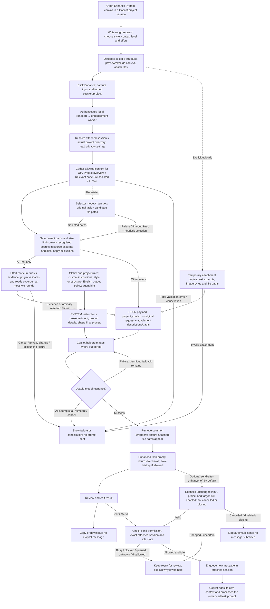

# How text becomes a Copilot prompt

Enhance Prompt creates a prompt in the canvas using a model from your GitHub Copilot account. Review the result, then send it to the attached session. The separate Enhance and send option requires explicit enablement; prompts entered directly into chat remain untouched.

This is the semantic source for the [README illustration](assets/prompt-workflow.svg), also available as a [standalone HTML page](assets/prompt-workflow.html). It describes the implemented Copilot port, not planned capabilities. The source map at the end identifies the code behind each stage.

## Canvas: write, enhance, review, send

### What the rewriting model receives

The rewriting model and Copilot have separate jobs. The rewriter produces text. Copilot receives that text as a task and carries out the work using its own session, tools and permissions.

| Part | Contents |
| --- | --- |
| System instructions | Built-in rewrite rules; selected style or structure; English output policy; custom instructions; applicable user rules; optional Copilot-specific guidance |
| User payload | The rough request inside `<request>`; allowed context items inside `<project_context>`; attached text excerpts and attachment paths |
| Images | Image bytes when the selected Copilot model reports image support; otherwise the request is rejected |
| Authentication | Existing Copilot SDK authentication, verified against the attached account; credentials are never inserted into the prompt |

The built-in instructions ask the model to preserve the user's intent and concrete details, use only grounded file names and commands, and return the final prompt without commentary. They require English for the rewritten instructions and headings even when custom rules or project context request another output language. The original request, custom rules and structures, Unicode, code, identifiers, paths, URLs, quoted text, errors and other user-supplied data remain intact. These are instructions to a model, not a guarantee that its answer is correct. Review remains useful.

For example, a request might be `Fix the login button overlapping the password field on phones.` If selected project context actually identifies `src/components/LoginForm.tsx` and the relevant test command, the result can name them. Without that evidence, the rewriter is instructed to ask the destination agent to locate the form instead of inventing a path. The result is a task description, not a code change.

### Context, attachments and model selection

| Context level | What this adapter can include, subject to privacy switches |
| --- | --- |
| Off | No gathered project context; explicit attachments and user rewrite rules still apply |
| Basic (saved selections only) | Workspace/session identity and destination-agent information |
| Project overview | Identity plus project instructions, README, stack/commands, file tree and configured extra context files |
| Relevant code | Project overview plus allowed Git information and relevant source excerpts |
| AI-assisted | Relevant code plus model-assisted file picking, capped at ten source files total; adds a selector request when candidates exist |
| AI Test | Relevant code plus at most two research rounds on the effort model; the plugin brokers safe reads/searches and sends actual excerpts into the final rewrite |

Preview does not call models. [AI Test research limits, failure behavior and privacy](context-levels.md#ai-test-experimental-follow-up-research) apply only to the new experiment. Research has no model fallback and does not change AI-assisted. With AI-assisted context, a selector profile/chain receives the original request and candidate file paths. The selector and rewrite chain use only Copilot profiles. Picker errors or timeouts retain heuristic file selection and let enhancement continue with a note. Files may change between preview and enhancement, so preview is not an immutable copy of the eventual request. Exclusions are applied to the enhancement run too. Turning off project-file access limits gathered context; it does not remove text the user explicitly attached or typed.

Project file reads reject sensitive filenames and escaping symlinks. Recognized secrets in automatically gathered project instructions, README/extra context, stack information, source excerpts and Git metadata/diffs are masked before truncation. File exclusions apply across automatic context routes and resolved link targets. Masking cannot identify every secret. Preview the context and exclude material you do not want sent.

Explicit attachments follow a separate path: the panel uploads them into the plugin's temporary attachment directory; only those copies can be loaded. Images are identified from their bytes. Attached text is excerpted, but it is not automatically secret-masked. The request and custom instructions are also supplied as written. Excluding an attached text item removes its content from the payload while its path remains listed. Treat text, images and paths you provide as data the selected Copilot models may receive.

The selected profile is tried first according to the configured model chain. When fallback is enabled, recoverable failures can try another eligible profile within the run's time budget. Every attempt uses an eligible Copilot profile. Retired external profiles cannot execute or silently become a Copilot model.

Enhancement creates a disposable helper using the desktop's existing SDK and runtime, with no npm install or download. It checks matching authenticated account/host, eligible Copilot models, actual model selection, an empty tool list and an isolated working directory before inference. Tools, hooks, plugins, skills, instruction discovery, memory and shared session storage are disabled. The helper receives the prepared payload and explicit image bytes, without attached-chat history. After generation it stops, preserves filtered usage accounting and removes its temporary state before returning text for review. Usage Insights groups the retained receipts under **Enhanced Prompt**, with a separate session per helper and no prompt or response text. The attached chat stays unchanged until Send. [Full lifecycle and compatibility limits](copilot-background-rewriting.md).

Progress travels back to the canvas. Long runs can resume across bounded panel requests. Cancelling, closing the owning canvas, or abandoning a run stops its work. Only a delivered successful run is eligible for canvas history; saving history obeys the privacy setting.

### The handoff to Copilot

Normal **Send** submits the text currently being reviewed. **Send right after enhancing** requires explicit opt-in and submits the run's own output after checking that the input, project and target are unchanged. A failed check leaves the result available for review.

Both use the attached session's normal message queue after an idle check. Busy, blocked, queued, disconnected or unknown states refuse the send. The plugin never answers a pending permission request. The SDK has no atomic idle-only send: work starting between the check and send can cause the new message to wait in the queue.

Prompts typed directly into Copilot chat are unchanged by the plugin. The [retirement note](chat-auto-enhance-retirement.md) preserves the former hook design and recovery source.

## Local data and trust boundaries

- The canvas and worker communicate through an authenticated loopback HTTP/SSE server. Copilot session access stays in the extension process.
- Profiles, preferences, user rules and history live in the plugin's local data directory. Project rules use canonical project paths; drafts and results are scoped to the session. Prompt text in saved history is not encrypted. Disabling history also stops persistence of sensitive panel fields.
- Copilot resolves existing authentication. The plugin accepts no API keys; migration removes legacy encrypted API-key entries while preserving unrelated local data.
- Copilot models receive the enhancement payload. Fallback, AI-assisted selection and AI Test may make additional Copilot requests. On Send, the attached session receives the enhanced task prompt, including retained attachment paths.
- The adapter does not gather terminal scrollback, other-agent context, tool activity or editor-save events. It cannot start an external agent. Unsupported terminal and editor controls are shown as unavailable.

## Implementation map

| Stage | Source |
| --- | --- |
| Canvas lifecycle and local transport | [extension.ts](../src/copilot/extension.ts), [server.ts](../src/copilot/server.ts), [transport.ts](../web/src/transport.ts) |
| Input, progress, cancellation and send-after checks | [panel/actions.ts](../src/panel/actions.ts), [protocol.ts](../src/protocol.ts) |
| Enhancement orchestration | [worker.ts](../src/worker.ts) |
| Project context, privacy and safe reads | [context/index.ts](../src/context/index.ts), [context/files.ts](../src/context/files.ts), [context/secrets.ts](../src/context/secrets.ts), [privacy.ts](../src/privacy.ts) |
| AI Test read-only research broker | [context/research.ts](../src/context/research.ts) |
| Explicit uploads and attachment loading | [attachments.ts](../src/attachments.ts) |
| System instructions, payload and response cleanup | [prompts.ts](../src/prompts.ts), [rules.ts](../src/rules.ts) |
| Model chain and Copilot helper | [models.ts](../src/models.ts), [Copilot models.ts](../src/copilot/models.ts) |
| Session identity, idle checks and message delivery | [session.ts](../src/copilot/session.ts), [services.ts](../src/copilot/services.ts) |
| Local state and migration | [storage.ts](../src/copilot/storage.ts) |

## Diagram scope

The illustration groups the canvas flow into two stages: build a rewrite request through Copilot, then review and send the result. The Mermaid source retains the failure, fallback, cancellation and optional-send branches. AI Test's detailed research limits are documented in [Context choices](context-levels.md#ai-test-experimental-follow-up-research).

The visual uses flat neutral colors and system fonts. The HTML is the editable visual source; the SVG is its README export. Both describe the current Copilot-only flow. The earlier hook diagram and its November 14, 2026 review remain recoverable at the commit recorded in the retirement note.
