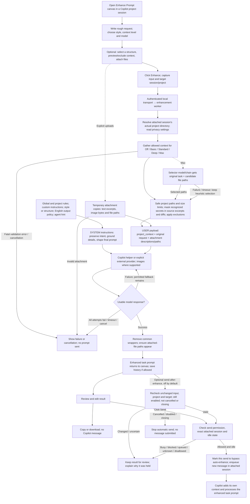
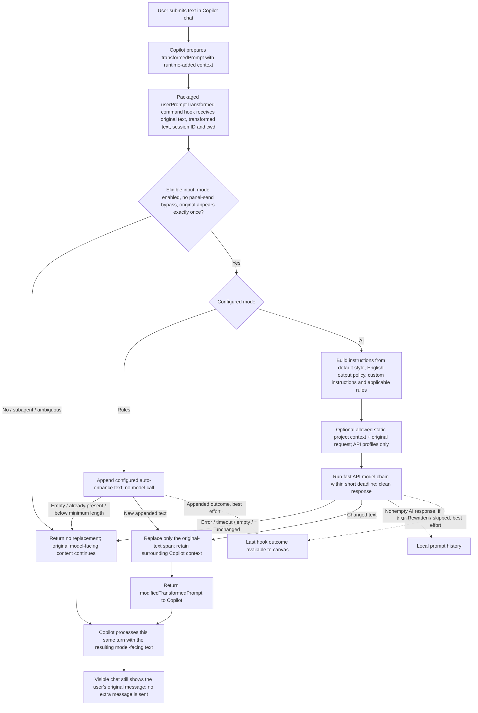

# How text becomes a Copilot prompt

Enhance Prompt has two entry points. The canvas creates a prompt you can review before sending. Optional chat auto-enhance changes the text Copilot's model receives during an existing chat turn. Both are shown below; they have different context and timing limits.

This is the semantic source for the [README illustration](assets/prompt-workflow.svg), also available as a [standalone HTML page](assets/prompt-workflow.html). It describes the implemented Copilot port, not planned capabilities. The source map at the end identifies the code behind each stage.

## 1. Canvas: write, enhance, review, send

### What the rewriting model receives

The rewriting model and Copilot have separate jobs. The rewriter produces text. Copilot receives that text as a task and carries out the work using its own session, tools and permissions.

| Part | Contents |
| --- | --- |
| System instructions | Built-in rewrite rules; selected style or structure; English output policy; custom instructions; applicable user rules; optional Copilot-specific guidance |
| User payload | The rough request inside `<request>`; allowed context items inside `<project_context>`; attached text excerpts and attachment paths |
| Images | Image bytes for supported providers. Copilot rejects attachments unless the model reports image support; external nonvision profiles receive paths only |
| Authentication | Copilot: existing SDK authentication, verified against the attached account; external providers: configured API key or CLI authentication. Keys are never inserted into the prompt |

The built-in instructions ask the model to preserve the user's intent and concrete details, use only grounded file names and commands, and return the final prompt without commentary. They require English for the rewritten instructions and headings even when custom rules or project context request another output language. The original request, custom rules and structures, Unicode, code, identifiers, paths, URLs, quoted text, errors and other user-supplied data remain intact. These are instructions to a model, not a guarantee that its answer is correct. Review remains useful.

For example, a request might be `Fix the login button overlapping the password field on phones.` If selected project context actually identifies `src/components/LoginForm.tsx` and the relevant test command, the result can name them. Without that evidence, the rewriter is instructed to ask the destination agent to locate the form instead of inventing a path. The result is a task description, not a code change.

### Context, attachments and model selection

| Context level | What this adapter can include, subject to privacy switches |
| --- | --- |
| Off | No gathered project context; explicit attachments and user rewrite rules still apply |
| Basic | Workspace/session identity and destination-agent information |
| Standard | Basic plus project instructions, README, stack/commands, file tree and configured extra context files |
| Deep | Standard plus allowed Git information and relevant source excerpts |
| Max | Deep plus a larger file selection and optional model-assisted file picking; this can make an extra model request |

Preview does not call the model-assisted file picker. At Max, a selector profile/chain receives the original request and candidate file paths. Copilot rewrites use only Copilot selector profiles; a saved external selector is replaced for that run by the chosen Copilot profile. External rewrites can use a different external selector provider. Picker errors or timeouts retain heuristic file selection and let enhancement continue with a note. Files may change between preview and enhancement, so preview is not an immutable copy of the eventual request. Exclusions are applied to the enhancement run too. Turning off project-file access limits gathered context; it does not remove text the user explicitly attached or typed.

Project file reads reject sensitive filenames and escaping symlinks. Recognized secrets in relevant source excerpts and Git diffs are masked before truncation. This is not a blanket filter: project instructions, README/extra context, stack summaries and Git metadata are not uniformly secret-masked. Preview the context and exclude material you do not want sent.

Explicit attachments follow a separate path: the panel uploads them into the plugin's temporary attachment directory; only those copies can be loaded. Images are identified from their bytes. Attached text is excerpted, but it is not automatically secret-masked. The request and custom instructions are also supplied as written. Excluding an attached text item removes its content from the payload while its path remains listed. Treat text, images and paths you provide as data the configured providers may receive.

The selected profile is tried first according to the configured model chain. When fallback is enabled, recoverable failures can try another eligible profile within the run's time budget. Copilot and external profiles are separate fallback groups: a run never crosses that boundary. API profiles call the configured remote or local endpoint. Subscription/custom CLIs run in an empty temporary directory with the supplied rewrite instructions and payload.

The Copilot preset creates a disposable helper using the desktop's existing SDK and runtime, with no npm install or download. It checks matching authenticated account/host, eligible Copilot models, actual model selection, an empty tool list and an isolated working directory before inference. Tools, hooks, plugins, skills, instruction discovery, memory and shared session storage are disabled. The helper receives the prepared payload and explicit image bytes, without attached-chat history. After generation it stops, preserves filtered usage accounting and removes its temporary state before returning text for review. Usage Insights groups the retained receipts under **Enhanced Prompt**, with a separate session per helper and no prompt or response text. The attached chat stays unchanged until Send. [Full lifecycle and compatibility limits](copilot-background-rewriting.md).

Progress travels back to the canvas. Long runs can resume across bounded panel requests. Cancelling, closing the owning canvas, or abandoning a run stops its work. Only a delivered successful run is eligible for canvas history; saving history obeys the privacy setting.

### The handoff to Copilot

Normal **Send** submits the text currently being reviewed. **Send right after enhancing** requires explicit opt-in and submits the run's own output after checking that the input, project and target are unchanged. A failed check leaves the result available for review.

Both use the attached session's normal message queue after an idle check. Busy, blocked, queued, disconnected or unknown states refuse the send. The plugin never answers a pending permission request. The SDK has no atomic idle-only send: work starting between the check and send can cause the new message to wait in the queue. A short-lived session-and-text hash tells the chat hook to leave a canvas-originated send unchanged, avoiding a second enhancement.

## 2. Optional chat auto-enhance: modify the same turn

Auto-enhance is off by default and can affect chat prompts in sessions where this plugin's hook is active, even without an open canvas. The runtime supplies the target session and project directory; switching desktop tabs does not choose the hook's project. Plugin or organization policy can prevent hooks from running.

**Rules mode** appends the dedicated auto-enhance text; it does not run the rewriting model or automatically append the Rules tab's contents. **AI mode** reuses the rewrite instructions and applicable user rules, but only takes optional static project context. It does not run Deep/Max context gathering, the file picker, canvas attachment loading, Copilot helpers or subscription CLIs. Short prompts below the configured minimum are left unchanged in both modes.

The worker gives the AI chain a 1.7-second budget minus setup time; key retrieval can add wall-clock time outside individual model timers. The command process has a 4.5-second outer deadline and the host configuration allows 5 seconds. An absent or ambiguous original-text span, error, empty answer or timeout preserves the original model-facing content. Surrounding runtime-added context is preserved byte for byte when replacement succeeds.

Rules mode records an appended outcome but no history entry. AI mode can save a nonempty response and record a rewritten outcome before the outer hook checks whether the response differs from the original, so an unchanged answer can still appear in history. Last-outcome reporting is best effort, especially if the process deadline ends the hook.

The hook uses the packaged command integration because registering an SDK prompt callback stalled extension startup in the tested installed runtimes. It returns a transformation for the existing turn and has no ability to call Send. [Auto-enhance details](auto-enhance.md).

## Local data and trust boundaries

- The canvas and worker communicate through an authenticated loopback HTTP/SSE server. Copilot session access stays in the extension process.
- Profiles, preferences, user rules and history live in the plugin's local data directory. Project rules use canonical project paths; drafts and results are scoped to the session. Prompt text in saved history is not encrypted. Disabling history also stops persistence of sensitive panel fields.
- Saved API keys use Windows DPAPI. Other platforms currently need an available environment key or a CLI's own authentication; saved API-key storage is unavailable there.
- Copilot or configured external providers/CLIs receive the enhancement payload. External fallback can send it to more than one external provider; Copilot runs stay within Copilot for rewriting and Max file selection. On Send, the attached Copilot session receives the enhanced task prompt, including retained attachment paths. The hook can also make an API rewrite request when AI mode is enabled.
- The adapter does not gather terminal scrollback, other-agent context, tool activity or editor-save events. It cannot start an external agent or issue desktop notifications; those controls are shown as unavailable.

## Implementation map

| Stage | Source |
| --- | --- |
| Canvas lifecycle and local transport | [extension.ts](../src/copilot/extension.ts), [server.ts](../src/copilot/server.ts), [transport.ts](../web/src/transport.ts) |
| Input, progress, cancellation and send-after checks | [panel/actions.ts](../src/panel/actions.ts), [protocol.ts](../src/protocol.ts) |
| Enhancement orchestration and hook modes | [worker.ts](../src/worker.ts) |
| Project context, privacy and safe reads | [context/index.ts](../src/context/index.ts), [context/files.ts](../src/context/files.ts), [context/secrets.ts](../src/context/secrets.ts), [privacy.ts](../src/privacy.ts) |
| Explicit uploads and attachment loading | [attachments.ts](../src/attachments.ts) |
| System instructions, payload and response cleanup | [prompts.ts](../src/prompts.ts), [rules.ts](../src/rules.ts) |
| Model chain, Copilot helper, HTTP providers and CLI execution | [models.ts](../src/models.ts), [Copilot models.ts](../src/copilot/models.ts), [llm.ts](../src/llm.ts), [cli.ts](../src/cli.ts) |
| Session identity, idle checks and message delivery | [session.ts](../src/copilot/session.ts), [services.ts](../src/copilot/services.ts), [sent.ts](../src/copilot/sent.ts) |
| Chat transformation and hook deadline | [hook.ts](../src/copilot/hook.ts), [hook-entry.ts](../src/copilot/hook-entry.ts), [hooks.json](../com.github.copilot/hooks/hooks.json) |
| Local state and saved credentials | [storage.ts](../src/copilot/storage.ts), [secrets.ts](../src/copilot/secrets.ts) |

## Diagram review and visual mapping

The two semantic diagrams were written first and checked independently against the implementation by two reviewers on November 14, 2026. One reviewed the canvas/context/model flow; the other reviewed the hook and native-session handoff. Both approved the corrected semantics before the diagram-design skill was used for styling.

The review corrected the masking limits, separate selector model, nonfatal selector failures, multiple-provider fallback, hook history/outcome distinction and timing budget. It also exposed an overlapping-match edge case in the hook; the implementation was corrected and a regression test verified that ambiguous text remains unchanged.

The semantic source has 42 nodes and 53 transitions across two diagrams. The illustration groups them into 18 boxes across three sections, with failure cases and shared infrastructure described beside the main paths:

| Source detail | Illustration treatment |
| --- | --- |
| Canvas startup, input capture and authenticated transport | Input box and section introduction; transport remains documented above |
| Project resolution, privacy, safe reads, selector and its failure branch | Context box plus selector-failure and data-sharing notes |
| Attachments, rewrite rules, system instructions and user payload | Three input sources feeding the two-part enhancement request |
| Model chain, fallback, cleanup, failure and history | Rewrite model and result boxes; failure and storage notes |
| Review, copying/downloading, opt-in send, cancellation and hold reasons | Separate review and optional-send paths feeding the session check |
| Hook bypass and normal queued delivery | Copilot handoff box and queue-race note |
| Hook input, eligibility and rules/AI branches | Chat, eligibility and mode boxes |
| Span replacement, unchanged fallbacks and same-turn processing | Two explicit result paths converging on Copilot |
| Hook timing, optional history and last outcome | Notes below the hook flow; exact reporting behavior remains in the prose |

The visual uses the panel's flat neutral palette and system sans-serif stack from [web/src/index.css](../web/src/index.css), with a near-white background and darker secondary text for contrast. It loads no external fonts. The HTML is the editable visual source; the SVG is its README export. Full branch detail remains in the Mermaid source rather than being squeezed into smaller text.
